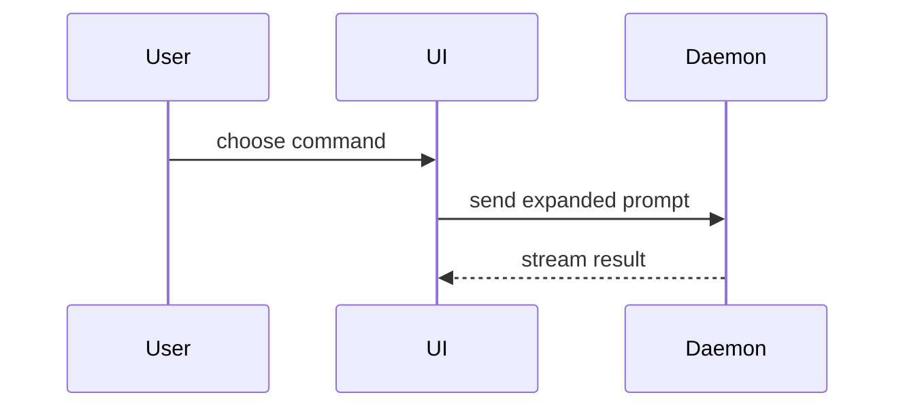

PR の本文は、このテンプレートで書け:

```markdown
## Summary

<diagram, diff-sketch, or tree>

## Evidence

- **Before:** <screenshot/output/failing test run>
  **After:** <screenshot/output/passing test run>

## Merge Danger

**Door:** <one-way or two-way>

<optional: description>

**Blast Radius:** <one-word description>

<optional: potential ramifications of merge>
```

## セクション

前置きはすべて省き、文章は短くしろ。`GLOSSARY.md` にあるユーザーのドメイン言語を使え。

### Summary

要点が伝わる最小の見せ方を選べ。

- ロジックやアルゴリズムは pseudocode で示す:

```text
on(save)
  if content is unchanged
    return cached result
  write new content
  return fresh result
```

- 実行時の制御の流れは call tree で示す:

```text
submitForm
  createSession
    persistPrompt
    launchAgent
  navigateToSession
```

- UI の構造は component tree で示す。意味のある state と module の境界も含める:

```text
<SessionPage> (apps/example/src/routes/session.tsx)
  useSessionEvents()
  <SessionToolbar>
    <RunSkillButton> (packages/ui)
```

- ファイルの責務や広い範囲の refactor は、浅い file tree で示す:

```text
src/
├── commands/       # parses user actions
├── sessions/       # owns session state
└── transport/      # sends API requests
```

- component の相互作用、制御の流れ、データの流れは Mermaid で示す:



- 要点が「何が変わるか」で、周りの形がすでにあるときは `diff` を使う。diff の形は話題に合わせろ。

component の変更なら:

```diff
 <SessionPage>
   useSessionEvents()
   <SessionToolbar>
+    <RunSkillButton />
   <SessionTimeline>
+    <SkillResultCard />
```

ファイルの配置の変更なら:

```diff
 src/
 ├── commands/
+│   └── show-me.ts       # expands the slash command
 ├── sessions/
-└── transport.ts
+└── transport/
+    ├── client.ts
+    └── stream.ts
```

call tree や call stack の変更なら:

```diff
 submitForm
   createSession
     persistPrompt
+    expandSkillMention
     launchAgent
-  navigateToSession
+  navigateToSession
+    subscribeToEvents
```

state や制御の流れの変更なら:

```diff
 on(save)
-  write content
+  if content is unchanged
+    return cached result
+  write new content
+  invalidate cache
```

- 大半が新しいとき、省いた context が所有や順序を隠してしまうとき、またはユーザーがコピーできる完成形を必要とするときは、ブロック全体を示す:

```ts
function expandSkill(command: string): string {
  const skillName = command.slice(1);
  return `use the ${skillName} skill`;
}
```

#### ガイダンス

それぞれの図は、それが支える短い文の隣に置け。残すのは、ユーザーのいまの問い、またはいまの論点を解決する選択肢に答えるのに必要な call、ファイル、props、state、境界だけだ。

1 つだけ使ってもよいし、いくつか使ってもよい。全部を使うことはまずない。判断して使い、ユーザーを圧倒するな。

### Evidence

変更が動くことの具体的な証拠。before と after を示せ。

スクリーンショットは S ランクだ。環境が整っていて、変更が見た目に関わるとき。

実行にもとづく証拠は A ランク。テストの結果、コンソールの出力。いま失敗して通るようになった正確なテストを、pseudocode で示せ。

### Merge Danger

one-way door か two-way door かを書け。two-way door は引き返せるが、one-way door は引き返せない。ロールバックが安い PR ほどリスクは低い。破壊的な操作や、覆しにくい判断を含む変更は one-way door だ。

blast radius とは、この PR が持ち込む変更の影響や範囲の見込みだ。あらゆる可能性を考えろ。たとえばレイアウトのずれ、利用側の破損、モバイルでの表示の崩れなど。
